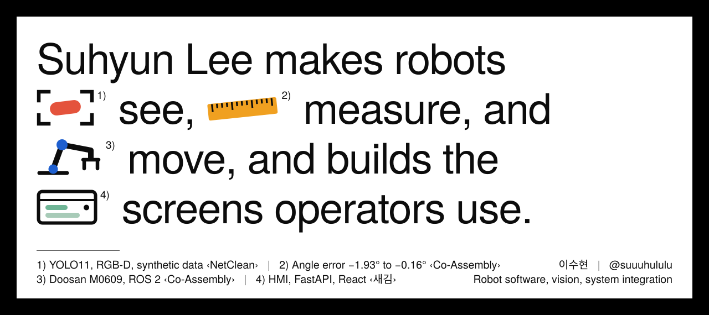
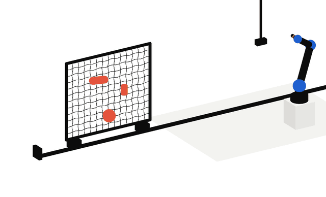
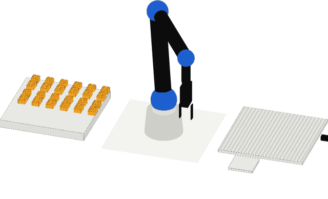
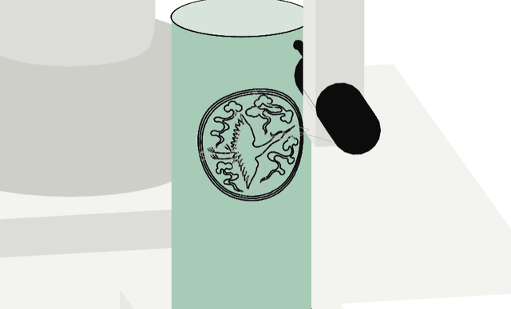
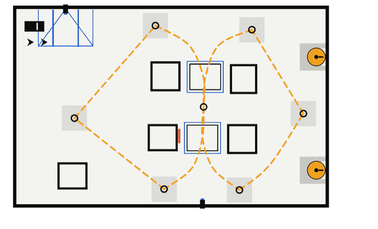

  

**카메라로 보고 · 직접 재고 · 로봇으로 움직이는 시스템**을 만듭니다.
비전 인식부터 로봇 동작, 운영 화면과 기록까지 한 흐름으로 연결하고, 결과는 테스트와 실측 수치로 확인합니다.

  
  

  
  
  
  
  
  
  
  
  
  
  

## Projects

두산 로보틱스 ROKEY Boot Camp 9기에서 팀장 · PM으로 진행한 네 프로젝트입니다.
카드의 애니메이션은 공정을 설명하려고 재구성한 시뮬레이션이며, 실제 시연 영상과 결과는 이미지를 누르면 열리는 저장소에 있습니다.

<table>
  <tr>
    <td width="50%" valign="top">
      
      <h3>NetClean</h3>
      Isaac Sim 디지털 트윈에서 로봇 2대가 폐어망을 자르고 이물질을 흡착해 떼어내는 공정  
      <b>역할</b> 팀장 · 비전 파이프라인 
      <b>결과</b> 절단 36/36 · 제거 18/18 · mAP50-95 0.994 
      ROS 2 · Isaac Sim 5.1 · YOLO11 · Doosan M0609 ×2
    </td>
    <td width="50%" valign="top">
      
      <h3>Adaptive Co-Assembly</h3>
      대화로 블록 의자를 설계하고, 사람과 협동로봇이 함께 조립하는 시스템  
      <b>역할</b> 팀장 · 로봇 제어 · HMI · DB · 웹 · 통합 
      <b>결과</b> 방향 오차 −1.93° → −0.16° · 통합 검사 279개 통과 
      ROS 2 · Doosan M0609 + RG2 · RealSense · PostgreSQL · PyQt5
    </td>
  </tr>
  <tr>
    <td width="50%" valign="top">
      
      <h3>새김 (Saegim)</h3>
      이미지 한 장을 실측한 원통 곡면의 조각 경로로 바꿔 양초에 새기는 음각 조각 자동화  
      <b>역할</b> 팀장 · HMI · FastAPI · ROS 게이트웨이 
      <b>결과</b> 실물 전 과정 6회 완료 · 반복 측정 표준편차 52 µm 이하 
      ROS 2 · Doosan M0609 · FastAPI · React · SQLite
    </td>
    <td width="50%" valign="top">
      
      <h3>기똥차 · AMR Patrol</h3>
      TurtleBot 4 두 대가 교대로 지하주차장을 순찰하며 화재 · 누수 · 적치물을 찾는 시스템  
      <b>역할</b> PM (8인 팀) 
      <b>결과</b> 4개 파트 통합 · 테스트 274개 통과 
      ROS 2 · TurtleBot 4 · Nav2 · YOLO11 · Flask
    </td>
  </tr>
</table>

## What I do

- **비전에서 로봇 동작까지 연결합니다.** 합성 데이터로 모델을 학습하고, RGB-D로 3D 목표를 계산해 로봇 액션으로 넘깁니다. 영상으로 방향을 보정하고 블록 중심을 찾아 파지합니다.
- **여러 모듈을 하나의 공정으로 통합합니다.** ROS 2 Action · Service로 인터페이스를 먼저 정하고, 설계 · 계획 · 인식 · 실행의 결과를 현재 작업과 대조한 뒤 다음 단계로 넘깁니다.
- **운영자가 쓰는 화면과 기록을 만듭니다.** 실시간 공정 상태를 보여 주는 HMI, 작업 이력 DB, 웹 아카이브까지 구현합니다.
- **상태를 구분해 설계합니다.** 명령 완료, 작업 확인, 저장 완료를 서로 다른 상태로 다루고, 확인되지 않은 성공을 만들지 않습니다.

## Tech stack

| 영역 | 기술 |
|---|---|
| Robot | ROS 2 Jazzy (rclpy · Action · Service) · Doosan M0609 · OnRobot RG2 · TurtleBot 4 |
| Vision | YOLO11 · OpenCV · RGB-D (RealSense) · Isaac Sim Replicator 합성 데이터 |
| Simulation | NVIDIA Isaac Sim 5.1 |
| HMI · Server · Data | FastAPI · React · PyQt5 · WebSocket · SQLite · PostgreSQL |
| Tools | Python · pytest · Git/GitHub · Docker |

## How I work

- **AI 코딩 에이전트와 협업하고, 결과는 직접 검증합니다.** Claude Code와 Codex로 구현 속도를 높이되, 단위 · 통합 시험과 실물 실측 수치로 확인한 것만 결과로 적습니다.
- **형태와 사용 경험을 함께 설계합니다.** 이미지를 곡면 조각 경로로 옮기는 일, 운영자가 한눈에 읽는 화면을 만드는 일처럼 보이는 것과 쓰이는 것이 만나는 문제에 강합니다.
- **기록을 남깁니다.** 설계 결정과 트러블슈팅을 문서로 남기고, 배운 내용은 [블로그](https://blog.naver.com/moltingdown)에 정리합니다.
